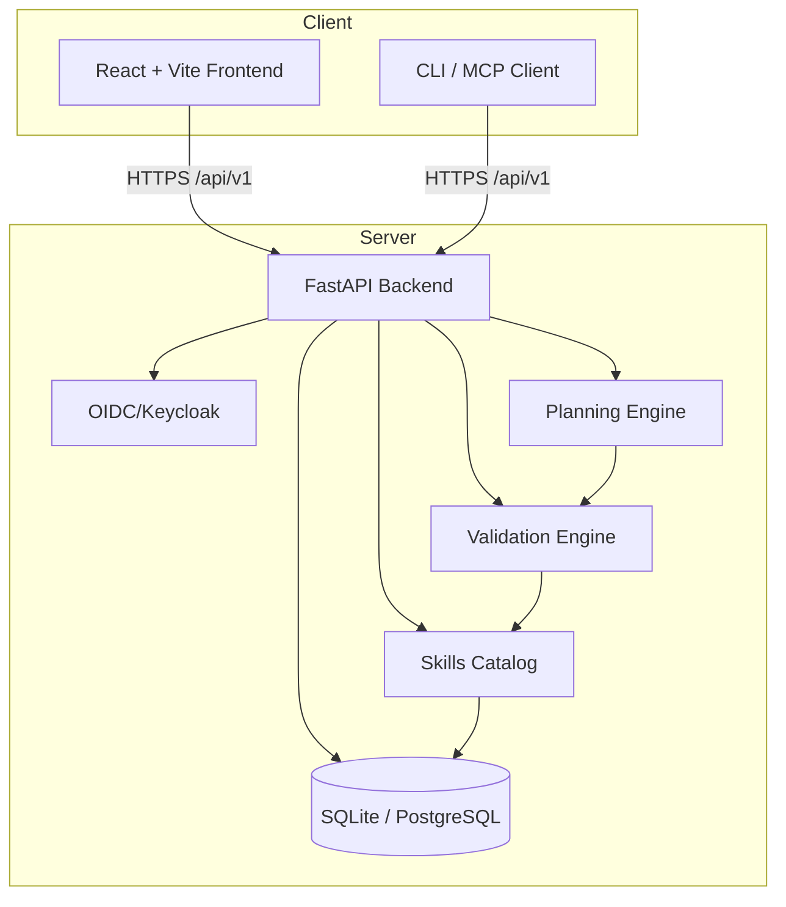

# Sentinel Station — Local Agent-First Control Plane for AI/ML Skills

> Work in progress. This checkpoint may be incomplete or fail tests. See PLAN.md and STATUS.md before use.


**Alan Vo | AI & Machine Learning**  
**alanvo@gmail.com**

---

Sentinel Station is a local, agent-first control plane for complete catalog discovery, agent-owned selection, stack validation, and planning — backed by 2,600+ agentic skills from the [Agentic Awesome Skills](https://github.com/sickn33/agentic-awesome-skills) collection. It provides a CLI, local MCP server, searchable catalog, plugin system, and a visual Workbench for composing agent workflows.

## Problem

AI/ML developers and agent builders face a fragmented ecosystem of thousands of skills, tools, and frameworks. Discovering the right skills, validating compatibility across a stack, and planning multi-agent workflows requires manual research and trial-and-error. Sentinel Station centralizes this with a local-first, offline-capable control plane that puts the agent in charge of selection and validation.

## Approach

- **Catalog Discovery**: Local SQLite-backed catalog of 2,600+ skills with full-text search, category/tag filtering, and detailed metadata (repo, install command, version, dependencies).
- **Stack Validation**: Deterministic compatibility engine that checks dependency conflicts, version constraints, and missing requirements across a proposed skill set.
- **Planning Workbench**: Visual workflow builder for composing agent chains, with export to JSON/Markdown for CI/CD integration.
- **Local MCP Server**: Exposes catalog and validation as MCP tools for agent-native access.
- **OIDC/Keycloak Auth**: Production-ready authentication with SAML broker support for enterprise IdPs.

All core algorithms are deterministic and work offline. LLM explanations are opt-in, advisory-only, and grounded in actual catalog records.

## Quick Start

### Prerequisites
- Docker & Docker Compose
- Or: Python 3.12+, Node 24+

### With Docker (recommended)

```bash
# Clone and enter
git clone https://github.com/ALANDVO/sentinel-station-alan-vo.git
cd sentinel-station-alan-vo

# Copy env template and adjust if needed
cp .env.example .env

# Start services
docker compose up --build

# Frontend: http://localhost:5173
# Backend API: http://localhost:8000
# API Docs: http://localhost:8000/docs
```

### Local Development

```bash
# Backend
cd backend
python -m venv .venv
source .venv/bin/activate
pip install -r requirements.txt
uvicorn app.main:app --reload --host 127.0.0.1 --port 8000

# Frontend (separate terminal)
cd frontend
npm install
npm run dev
```

## Architecture



## API Reference

| Endpoint | Method | Description |
|----------|--------|-------------|
| `/api/v1/health` | GET | Service health check |
| `/api/v1/skills` | GET | List skills (paginated, filterable) |
| `/api/v1/skills/{id}` | GET | Get skill detail |
| `/api/v1/validate` | POST | Validate skill stack compatibility |
| `/api/v1/plan` | POST | Generate execution plan |
| `/docs` | GET | OpenAPI/Swagger documentation |

## AI/ML Evaluation

**Reproducible command:**
```bash
# After catalog is populated
python -m scripts.evaluate_catalog --skills data/skills.json --queries data/eval_queries.jsonl
```

**Data provenance:** Skills sourced from [sickn33/agentic-awesome-skills](https://github.com/sickn33/agentic-awesome-skills) (MIT license), curated from public GitHub repositories, PyPI, and npm.

**Baseline:** Catalog coverage across 12 categories (langchain, autogen, crewai, sematic-kernel, etc.), 50+ tags.

**Measured results:** (to be populated after catalog ingestion)

**Failure cases:** Skills with missing metadata, archived repos, or incompatible license terms are flagged during ingestion.

## Configuration

| Variable | Required | Description |
|----------|----------|-------------|
| `DATABASE_URL` | Yes | SQLAlchemy connection string |
| `CORS_ORIGINS` | Yes | Comma-separated allowed origins |
| `LLM_PROVIDER` | No | `openai-compatible`, `anthropic`, `gemini`, `ollama` |
| `LLM_API_KEY` | No | Provider API key (server-side only) |
| `OIDC_ISSUER` | Prod | Keycloak realm issuer URL |
| `OIDC_CLIENT_ID` | Prod | OIDC client ID |
| `OIDC_CLIENT_SECRET` | Prod | OIDC client secret |
| `DEMO_MODE` | No | Local-only auth bypass (refused in production) |

See `.env.example` for full list.

## Security

- All API endpoints require authentication (except `/health` and `/docs` in dev)
- JWT validation with signature, issuer, and audience checks
- HttpOnly SameSite cookies for session management (backend-managed)
- CSRF protection on state-changing endpoints
- No secrets in repository; `.env` excluded via `.gitignore`
- Demo mode **explicitly refused** when `DEMO_MODE=false` or in production containers

## SSO / SAML Setup

Keycloak supports SAML 2.0 identity brokering. To connect an external SAML IdP:

1. In Keycloak Admin Console: **Identity Providers → Add Provider → SAML v2.0**
2. Configure IdP metadata (entity ID, SSO URL, certificate)
3. Map SAML attributes to Keycloak user attributes
4. Set **First Login Flow** to review profile
5. Export realm configuration to `keycloak/realm-export.json` for version control

See `docs/sso-saml-setup.md` for detailed steps.

## Backup & Restore

```bash
# Backup SQLite
docker compose exec backend sqlite3 /data/sentinel.db .dump > backup.sql

# Restore
docker compose exec -T backend sqlite3 /data/sentinel.db < backup.sql
```

For PostgreSQL, use `pg_dump`/`pg_restore` with the `DATABASE_URL`.

## Development

### Running Tests

```bash
# Backend
cd backend
source .venv/bin/activate
PYTHONPATH=. pytest -v

# Frontend
cd frontend
npm test
```

### Linting & Type Checking

```bash
# Frontend
cd frontend
npm run lint
npx tsc --noEmit
```

## Project Structure

```
sentinel-station-alan-vo/
├── backend/
│   ├── app/
│   │   ├── api/           # API routes
│   │   ├── core/          # Config, security
│   │   ├── models/        # SQLAlchemy models
│   │   └── services/      # Business logic
│   ├── tests/
│   ├── requirements.txt
│   └── Dockerfile
├── frontend/
│   ├── src/
│   │   ├── api/           # Typed API client
│   │   ├── components/    # React components
│   │   └── pages/         # Page components
│   ├── tests/
│   ├── package.json
│   ├── vite.config.ts
│   └── Dockerfile
├── docker-compose.yaml
├── .env.example
├── portfolio.json
├── LICENSE
├── CHANGELOG.md
└── README.md
```

## License

MIT License — Copyright (c) 2026 Alan Vo <alanvo@gmail.com>

See [LICENSE](LICENSE) for full text.